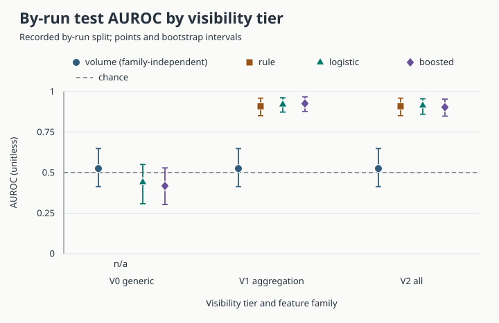
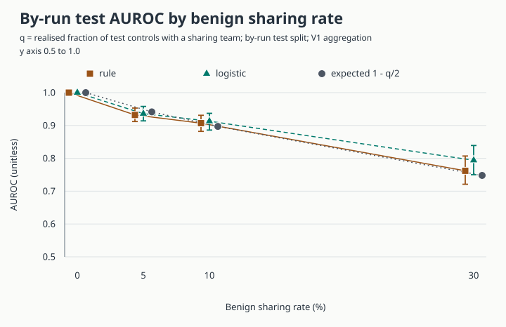
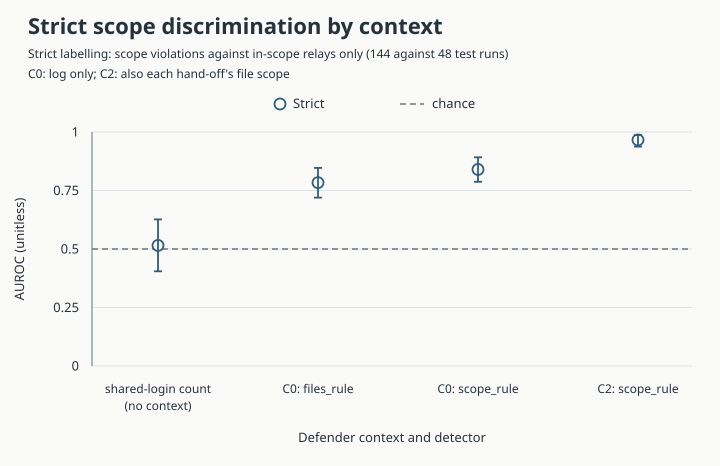
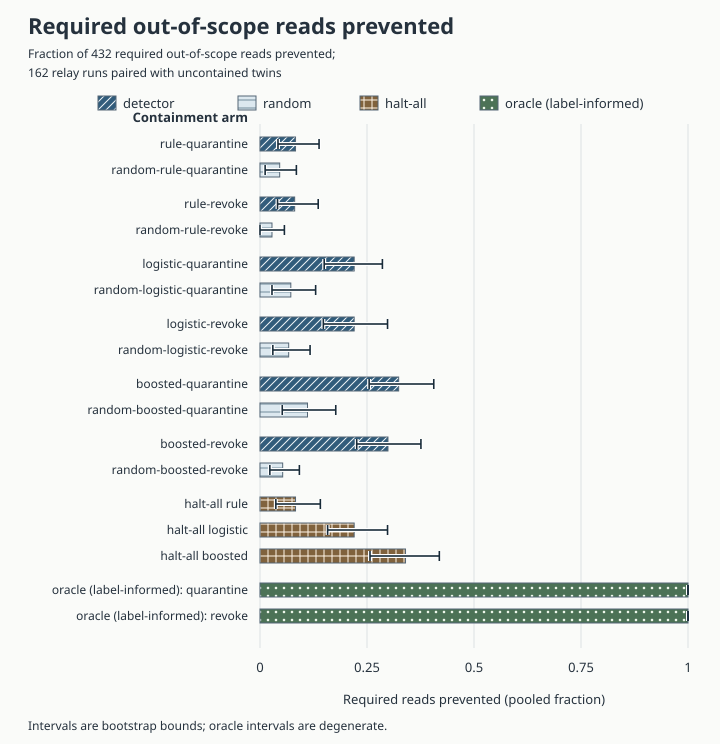

# swarm-detect

swarm-detect asks whether logs can reveal AI agents acting in concert. The name
states the aim, not a result. The Python package and command are named
`swarmtrace`.

The main study is a simulation with scripted agents: can a tool-call log
separate a credential relay from benign teamwork? With access logs alone it
cannot. With audit logs, detectors reach AUROC 0.92, but the chosen rate of
benign credential sharing sets that number: separation is exact against
controls with no sharing team and chance against controls with one, and a
parameter-free count of sharing pairs ranks as well as the fitted models. At a
5% false-positive target, 7 to 14 of 32 relay runs are flagged. Knowing each
hand-off's file scope separates relays that exceed it (AUROC 0.97). Containment
driven by these detectors prevents 8 to 32 percent of out-of-scope reads; most
relay runs are never flagged.

It is an observability and evaluation study, not a detection method. The
simulation says nothing about real attackers, real agents or real
organisations. A separate small pilot with real agents tested one detector,
which did not meet its pre-set bar.

| Question | Answer in this simulation | Source |
| --- | --- | --- |
| Do access logs separate a relay from teamwork? | No: AUROC 0.42 to 0.53 | [data/headline.md](data/headline.md) |
| Do audit logs? | AUROC 0.92, set by the 10% sharing rate | [data/headline.md](data/headline.md) |
| Does the number move with the sharing rate? | 1.000 at 0%, 0.76 at 30% (rule), as 1 - q/2 predicts | [data/sharing-sweep.md](data/sharing-sweep.md) |
| Does the obvious evasion work? | For pairs and peer rings, completely | [data/evasion.md](data/evasion.md) |
| What does knowing task scope buy? | 0.84 from the log, 0.97 with scope | [data/scope.md](data/scope.md) |
| Does acting on a flag prevent harm? | 8 to 32% of it; an oracle prevents all | [data/containment.md](data/containment.md) |

On two independent simulation seeds, using session breadth to break ties in
the scope rule detected 903 of 972 violations, up from 678. False alerts rose
from 6 to 67 among 1,296 controls. The existing C2 logistic model detected
955 violations with 68 false alerts. The follow-up also measures audit-only
detectors and reports the one-file cases. [Detector accuracy study](docs/detector-accuracy.md)

Recording the authorization used for a file read correctly linked 12 of 13
labelled reads, compared with five using the login history. A second agent
reading the same excluded file changed zero one-file detections on 756 held-out
runs. [Read attribution and false-alert benchmarks](docs/read-authorization-round.md)

When a separate office team held two simultaneous assignments, counting files
under their verified grant recovered 59 more one-file violations in 540 cases.
On a second office layout, it recovered 102 more in 540 cases at a 3.84%
false-alert rate, but flagged 55 in-scope relay controls versus 44 for
logistic. Use `review-reads --by-grant` to investigate file access. Logistic
remains the default for swarm alerts.
[Grant-count experiment](docs/grant-scope-round.md) and [research review](docs/swarm-detection-research.md)

Scoring each grant separately detected 519 of 540 one-file violations on two
new office workflows, versus 37 for whole-run logistic scored in log odds.
False alerts fell from 94 to 74 per 2,160 controls. In two earlier office
layouts, the same score flagged every clerk who accidentally opened an appendix
after finishing the approved files. Those mistakes alone triggered alerts on
at least 24.44% and 23.98% of the control runs. Use `review-assignments` to inspect access
exceptions. A separate document-office replay verified 7 of 10 completed
unapproved downstream uses, with zero alerts on 13 known negatives. Every
verified alert arrived at or after the effect.
[Assignment benchmarks and review command](docs/assignment-round.md) and
[recipient approval and version receipts](docs/recipient-approval.md)

On 58 held-out public approval tickets executed in the local office, checking
the recipient at dispatch warned before 17 of 32 unapproved uses and flagged
15 of 26 control tasks. Checking the committed version confirmed 23 of 32
with zero control alerts. On the 58 tasks, two model reviewers from different
model families agreed with each other on all three observable questions and
with the office record on read exceptions (39) and completed effects (32),
and both found cooperation in 50. They agreed on intent in 50 of 58 (kappa
0.65) and both left it unresolved in 39; this is not human review. On a
separate human-rated transfer benchmark, both a parser and a zero-shot model
missed all six held-out required transfers.
[Public ticket benchmark](docs/public-dispatch.md) and [human-rated text comparison](docs/approval-text.md)

In nine recorded Claude Code scenarios, the most recently started worker was
the wrong caller on 5 of 10 calls during overlap. Native IDs linked all 21
tagged child calls to their results. The offline reviewer also matched both
parallel Grok workers across different start and stop session IDs.
[Native hook evidence](docs/native-hook-review.md) and [assessment of nine external repositories](docs/external-repository-review.md)

Checking the permission in force at the worker's write confirmed 20 of 26
unapproved uses and flagged zero of 32 controls in the local office. A final
permission snapshot found 20 but falsely flagged ten controls. A retained
issuer copy also resolved the nine earlier missing approvals. All 58 paired
clerical and deliberate uses still gave identical audit evidence.
[Operation-time test](docs/operation-authority.md) and [comparison with the field as of November 23, 2026](docs/field-assessment.md)

On 24 pre-specified runs, 21 of them with real model-driven agents, the
frozen swarm detector flagged 7 of 10 runs assigned to a coordination
condition and none of 14 others. It caught 5 of 5 groups that coordinated
through shared notes and 2 of 5 that fanned out to subagents. Its ranking
score was 127/160 against a pre-set bar of 128/160, so the detector is
reported as not established. On the published log of a real agent incident it
alerted on 1 of 15 days, two weeks after a human moderator; a count of
distinct names alerted on the first day.
[Agent pilot and incident test](docs/agent-pilot.md)

## Setup

Agents and tools run in a local, deterministic simulation with no network
access. A run has 12 to 28 agents and one to three coordinated groups.

- **The offence** is a credential relay: one member of a group hands its
  credential to another, who logs in with it to do work it is not authorised
  for.
- **Benign teams** do the same work by delegation under their own
  credentials. By default 10% of benign teams share a credential sloppily
  instead, which looks exactly like a relay.
- **The defender** sees only the log, at one of three tiers: V0, access logs
  (agent, tool, target, status, time); V1, audit logs (also arguments, so
  credential ids, and result sizes); V2, full instrumentation (also content
  and provenance).
- **Detectors**: a volume baseline; a parameter-free rule that counts pairs of
  agents with a shared-credential login; fitted logistic and boosted models.
  Thresholds are set by split-conformal calibration at a 5% false-positive
  target, on runs kept apart from fitting and from the test set.
- **Controls**: an all-benign sweep, a deliberately loud relay, and shuffled
  labels.

Labels and run conditions are stored beside each log and are removed before
any detector sees a run. The design is in [docs/design.md](docs/design.md) and
[docs/design-phase3.md](docs/design-phase3.md).

## Main result

From the by-run split of the main dataset: 32 relay runs and 86 control runs
in the test set. The full account, with hold-outs, online timing and controls,
is in [RESULTS.md](RESULTS.md).

1. **Access logs show nothing.** At V0, and with generic coordination features
   at any tier, every detector is near or below 0.5 (logistic 0.440, boosted
   0.418). Relay and delegation are identical at V0 by construction, so this
   is also a check that nothing leaks the label.
2. **Audit logs reach 0.92, and the sharing rate sets that.** Logistic scores
   0.920 [0.873, 0.961] and boosted 0.926 [0.877, 0.967]. 14 of the 86 test
   controls contain a sharing team. If those tie with relays at random and all
   other controls are separated, the expected AUROC is 1 - (14/86)/2 = 0.919.
   Against controls with no sharing team, separation is exact.
3. **The obvious rule ranks as well as the fitted models.** Counting pairs
   with a shared login gives 0.909 [0.851, 0.959]; over 20 split seeds the
   means are 0.928 for the rule and 0.923 and 0.924 for the fitted models.
4. **0.92 is not a 92% detection rate.** At the calibrated threshold, logistic
   flags 14 of 32 relay runs and the rule 7 of 32, with 5 and 4 of 86 controls
   flagged. Small groups mostly pass: logistic flags 2 of 13 two-member
   relays and 6 of 7 five-member relays.
5. **Attribution has the same limit.** With the audit-log features, the pair
   scorer names 97 of 97 offensive agents in the test set, and 97 of the 176
   agents it names are offensive. Every wrongly named agent belongs to a
   benign team that shares a credential.

A log can show that a credential was shared. In the main dataset it cannot
show why, because a relay group and a sloppy team run the same code.



## Four follow-up experiments

Each is a separate sweep with its own recorded table. Each is one dataset, one
split and one seed; only the main result has a split-stability check.

### The headline number is set by the sharing rate

[data/sharing-sweep.md](data/sharing-sweep.md): four independent datasets at
benign sharing rates of 0, 5, 10 and 30 percent, 1,782 runs each.

- With no sloppy sharing, every detector separates relay runs exactly. At
  every rate, controls with no sharing team are separated exactly.
- The rule's AUROC is 0.932 [0.912, 0.953], 0.907 [0.882, 0.931] and 0.762
  [0.721, 0.807] at rates 5, 10 and 30. With q the fraction of test controls
  that contain a sharing team, the expected value is 1 - q/2: 0.941, 0.897 and
  0.748. Each interval contains it and none contains 1 - q.
- Matched on the number of sharing-like teams in a run, the rule scores relay
  runs against sharing controls at 0.46 to 0.52. Team for team, a relay group
  and a sloppy team look alike to it.
- The fitted logistic model does slightly better at rate 30, 0.794 [0.750,
  0.839] against an expected 0.748, probably because the mix of team sizes
  differs between relay groups and sloppy teams. That explanation was not
  tested.
- Detection at the calibrated threshold falls as sharing rises: the rule flags
  25, 12 and 3 of 49 relay runs at rates 5, 10 and 30.

A first sweep of 792 runs was too small to distinguish 1 - q/2 from 1 - q and
was replaced by this one before any conclusion was written.



### The named evasion works, except for five-member hubs against the fitted detectors

[data/evasion.md](data/evasion.md): in the owner-silent relay the credential's
owner never logs in with it, so the borrower is its first user and the
shared-login feature has nothing to count. 54 conditions were run on the same
seed in both styles and scored by detectors frozen from the main dataset. The
relay's objective completed in 54 of 54 runs in both styles.

- Relay runs flagged, standard against owner-silent: rule 11 and 2 of 54,
  logistic 20 and 8, boosted 28 and 11.
- For pairs and peer rings with no benign sharing team in the run, no detector
  flags anything: 0 of 31, the same as controls with no sharing team, 0 of 72.
  Three-member hubs are also flagged 0 of 9 times.
- In a hub, several members borrow one credential, and the second borrower
  still counts as sharing with the first. Five-member hubs are flagged by
  logistic in 7 of 9 runs and by boosted in 8 of 9; the rule flags none. The
  logistic margin is thin: seven of those runs share one feature vector that
  scores 0.718 against a threshold of 0.717. Boosted's margin is wider, 0.698
  against 0.671.
- Two-member groups gain almost nothing: they were nearly undetected already
  (1 of 18 by logistic).

The breakdown by group shape was added after an 18-run exploratory probe on
other seeds, run after the prediction was committed and before the sweep. It
is post hoc.

### Scope: what context buys

[data/scope.md](data/scope.md), [data/scope-identical.md](data/scope-identical.md):
here the offence has a behaviour of its own. Every hand-off has a task scope,
a set of files. A sloppy team and an in-scope relay use the borrowed credential
inside it. A scope violation also reads 1, 2 or 5 files outside it. Benign
agents make out-of-scope mistake reads at 0, 2 or 5 percent. The defender has
one of three context levels: C0, the log only; C1, also which agent each
credential belongs to; C2, also the scope of each hand-off. Only a violation
counts as the offence; an in-scope relay is a control. The test set has 144
violations and 195 controls, 48 of them in-scope relays.

The identical-policy control held exactly: in 108 of 108 pairs, a control
whose teams all share and an in-scope relay of the same shape on the same seed
produced byte-identical logs and context files.

AUROC is for violations against in-scope relays only, the hardest comparison.
The flagged counts are at each rule's own calibrated threshold, against all
195 controls.

| Defender has | Rule | AUROC | Violations flagged | Controls flagged |
| --- | --- | --- | --- | --- |
| Shared-login count only | pairs with a shared login | 0.515 | 7 of 144 | 5 of 195 |
| C0 | distinct files read per agent, ignoring logins | 0.784 [0.720, 0.847] | 48 of 144 | 2 of 195 |
| C0 | files first read after a borrowed login | 0.840 [0.787, 0.892] | 88 of 144 | 0 of 195 |
| C2 | reads outside the hand-off's scope under a borrowed credential | 0.966 [0.938, 0.987] | 102 of 144 | 1 of 195 |

- Shared-login features cannot tell a violation from an in-scope relay. The
  fitted models do no better (0.446 and 0.433).
- At C0, most of the gain in ranking comes from a violating agent reading
  more files: a count that ignores logins reaches 0.784. At the threshold,
  requiring a borrowed login first helps more, because most controls have no
  borrowed login and score zero. The two rules sit at their own thresholds, so
  this compares operating points, not signal strength.
- C1 adds nothing over C0 here: the two levels' features are identical in all
  1,134 runs, because every owner logs in before any borrower. Under an
  owner-silent relay that would not hold, and C1 would matter. That was not
  tested.
- At C2 with no benign mistakes, separation is exact. With mistakes it is
  0.961 at a 2 percent rate and 0.946 at 5 percent.
- Small violations stay hard at the threshold. By violation size 1, 2 and 5,
  each of 48: the C0 rule flags 14, 26 and 48; the C2 rule flags 6, 48 and 48.



### Containment: mostly a coverage problem

[data/containment.md](data/containment.md): 162 relay runs with a scope
violation and 108 control runs, each paired with an uncontained twin on the
same seed. When a frozen detector flags a run at a checkpoint, every 8 ticks,
a controller quarantines the agents it names or revokes the credentials they
borrowed. The uncontained twins read all 432 required out-of-scope files.

| Arm | Required reads prevented, of 432 | Benign ok calls lost, relay runs |
| --- | --- | --- |
| Rule, quarantine / revoke | 36 / 35 | 1.4% / 0.9% |
| Logistic, quarantine / revoke | 95 / 95 | 2.2% / 1.4% |
| Boosted, quarantine / revoke | 140 / 129 | 1.9% / 1.2% |
| Random, matched to each arm above | 12 to 48 | 2.8% to 9.1% |
| Halt every agent at the first flag | 36 / 95 / 147 | 14.5% / 29.8% / 40.3% |
| Oracle, one tick after the relay | 432 | 0 |

- Containment prevents 8 to 32 percent of the required out-of-scope reads.
- The shortfall is mostly coverage. For boosted with quarantine, of 292
  unprevented files, 218 are in runs never flagged and 74 are in flagged runs
  where the intervention came after some or all of the reads. Of its 80 flagged runs, 27 prevented
  nothing. An intervention at the first checkpoint after the relay would have
  preceded the first required read in 132 of 162 runs, so the 8-tick cadence
  is not the limit; how soon and how often the detector fires is.
- Coverage follows group size. Of 54 relay runs at each size 2, 3 and 5, the
  rule flags 2, 4 and 30; logistic 8, 16 and 38; boosted 7, 33 and 40.
- Whenever an intervention reached the collecting agent before its first
  required read, prevention was complete, in every arm. In this simulator
  interventions cannot be evaded, so that holds by construction. The oracle
  is an upper bound, not evidence about real interventions.
- Each detector arm beats its matched random arm: boosted with quarantine by
  92 files [63, 123].
- Halting every agent prevents at most 7 more files than quarantine and costs
  15 to 40 percent of benign ok calls.
- Revocation costs fewer benign ok calls than quarantine, by 2,088 to 4,068
  over all 270 runs. But the owner of a revoked credential is locked out of
  its own host, which follows from the simulator's design: one credential per
  host and no reissue. In the detector arms that was 56, 88 and 85 benign
  lenders.
- On control runs the frozen detectors flag 2, 7 and 9 of 108. Within a
  flagged control run the benign cost under quarantine is a median 13 to 30
  percent of that run's benign ok calls (range 9 to 44), and 8 to 18 percent
  under revocation.



Objective completion is not the measure of harm prevented. With boosted and
quarantine the relay's objective completes in only 86 of 162 runs, but in 23
of those 76 failures every required read had already happened.

## Predictions

Six predictions were written down before the sweep they concern was run and
before any detection result from it was seen. The commit order that shows
this is not part of this release. Mechanism tests on simulated
scope runs, including some on the scope dataset's own seeds, had already run
when the scope and containment predictions were written. "Little" in
prediction 4 had no threshold set in advance.

| # | Prediction | Outcome |
| --- | --- | --- |
| 1 | At C0 the breadth feature separates only the largest violations | Wrong as worded. It ranks one-file and two-file violations above in-scope relays (0.675 and 0.845). At the threshold only five-file violations are reliably flagged |
| 2 | At C2 separation is limited by the benign mistake rate | Held: exact with no mistakes, 0.961 and 0.946 with them |
| 3 | C1 adds nothing over C0 | Held exactly in this grid |
| 4 | With checkpoints every 8 ticks and detection that mostly arrives at or after completion, containment prevents little | Held for the rule (8%), arguable for boosted (32%). The stated reason was wrong: most runs are never flagged |
| 5 | Revocation costs less benign work than quarantine | Held for benign ok calls and tasks. Benign agents affected: 1, 11 and 4 more under quarantine, small and not consistent. Almost all of revocation's cost is owners locked out of their own hosts |
| 6 | With the owner silent, the feature is zero for the relay group and detectors flag at about the control rate | Held for pairs and peer rings. The feature is not zero in hubs of three or more, and detection did not fall to the control rate for five-member hubs against the fitted detectors |

The acceptance rule for the identical-policy control, byte-identical logs in
every twin pair, was met in 108 of 108 pairs. Known before the containment
runs: revoking a relayed credential locks its owner out of its own host.

## Limits

The simulator:

- Agents are scripted policies, not LLM agents. Nothing reacts to being
  watched or contained.
- In the main dataset the offence is a colluding group of two to five scripted
  agents in a population of 12 to 28. Despite the project's name, nothing in
  this repository addresses swarms in the swarm-robotics sense of large,
  decentralised populations whose coordination emerges from local interaction.
- The offences and the features that detect them were designed together. The
  contribution is the controlled measurement, not the features.
- Shared-credential use is known bad practice that a defender can already
  alert on.
- In the main dataset a relay group and a sloppy team run the same code, so
  intent is not measurable there. The scope experiment gives the offence a
  behaviour of its own; its scope records are assumed complete and correct.
- The sharing rate, mistake rates and group shapes are chosen, not measured
  from any organisation.
- Each host accepts one credential and credentials are not reissued.
  Interventions take effect at the next tick and cannot be evaded.
- At V1 a relay hand-off is a fixed 11 bytes longer than a delegation
  hand-off. No feature reads sizes.
- The log is assumed complete and unaltered.
- Control runs record `offence_style=credential_relay`, and owner-silent runs
  record `evasion=none`, in their label-side condition. Neither is in the log.

The statistics:

- Split-conformal thresholds control the false-positive rate on average over
  calibration sets, not for the one calibration set drawn. They need at least
  19 calibration controls to fire.
- Each follow-up experiment is one dataset, one split and one seed.
- Hold-outs of channel and topology apply to the relay group only.
- Test sets are small. 32 relay runs in the main result; 3 loud runs.
- The loud-control pass rule was revised after one detector failed the
  original.
- The by-run split seed shares a spawn key with one simulation seed. It was
  left unchanged to avoid re-drawing the split after results were seen.
- The detectors used for containment were calibrated on data without scope
  files.
- Where every bootstrap resample gives the same value the interval is marked
  degenerate. It does not establish that value.
- The generated reports state three things loosely: a column in
  [data/scope.md](data/scope.md) counts scores at or above the threshold while
  runs are flagged only above it; the first-collector-intervention tick in
  [data/containment.md](data/containment.md) is an evaluation-side measure;
  "pairs" in [data/evasion.md](data/evasion.md) means directed pairs, and
  that report cannot be rebuilt from its run table alone; a note in
  `data/scope.md` credits one threshold to in-scope relays alone, although
  three sharing controls contribute to it too.

Not tested:

- LLM-driven agents in the simulation. The
  [agent pilot](docs/agent-pilot.md) used LLM-driven agents that were not
  trying to hide.
- Any adaptive adversary.
- Evasion of the scope features. An owner-silent relay under scope.
- Content relay: a group that colludes by relaying content, not credentials.
  It is invisible at V0 and V1 by construction. One write-side defence against
  a form of it, durable poisoned memory, is the author's
  [Ziggurat](https://github.com/patschmittdev/Ziggurat).
- A re-test of the loud control on fresh runs, and hold-outs of channel and
  topology for every team. Both were planned and cut.

## Reproduce

Python 3.12 and the versions in `uv.lock`. Every command, grid and seed is in
[docs/reproduce.md](docs/reproduce.md). Run it from a clone of this
repository. It is not published to a package index, and the `swarmtrace`
package on PyPI is an unrelated project.

```shell
uv sync --python 3.12 --extra dev --frozen
uv run --frozen pytest -q -p no:cacheprovider
uv run --frozen swarmtrace verify --data data
```

CI runs the tests, including regeneration of sample runs, and `verify` on
Windows and Linux.

`verify` checks every recorded table and raw sample against its SHA-256. It
does not hash the text of the experiment reports or `split-stability.md`. A
source-digest warning is expected once any source file has changed since the
data was recorded. To regenerate, write to a fresh directory and compare:

```shell
uv run --frozen swarmtrace reproduce --seed 20261120 --out reproduce-out --workers 4
uv run --frozen swarmtrace sharing-sweep --seed 20261120 --out sharing-sweep-out --workers 4
uv run --frozen swarmtrace evasion --seed 20261120 --out evasion-out --workers 4
uv run --frozen swarmtrace scope --seed 20261120 --out scope-out --workers 4
uv run --frozen swarmtrace containment --seed 20261120 --data data --out containment-out --workers 4
```

| Command | Runs | Time on 4 workers |
| --- | --- | --- |
| `reproduce` | 417 | about 5 minutes |
| `sharing-sweep` | 7,128 | about 27 minutes |
| `evasion` | 108 | under 1 minute |
| `scope` | 1,350 | about 6 minutes |
| `containment` | 270 pairs | about 12 minutes |

To replace the recorded sharing sweep, copy the output into `data/` with
`Copy-Item` (or `cp -r`) and run `verify`: verify checks the sweep hashes and
fails on a missing or changed file. The other experiments work the same way.

## Recorded data

`data/` is 16 MB. It holds the main dataset's feature tables at all three
tiers, 16 raw sample runs (ten from the main, benign and loud sweeps and two
each from the evasion, scope and containment experiments), each experiment's
run-level table and report, and
`experiment.json` with the hash of every main artifact, the lock file and the
source tree. The figures in `docs/figures/` are drawn from these tables by
`swarmtrace figures --data data --out docs/figures`. Reports end with a hash block for their own tables. Details are
in [docs/reproduce.md](docs/reproduce.md).

## Related work

The work on collusion among AI agents reviewed here mostly gives the monitor
more than a log. Motwani et al. [1] study steganographic collusion and monitors that read
message content. Rose et al. [2] detect collusion from model activations.
Nakamura et al. [3] audit collusion both from messages, with an LLM judge, and
from actions, with regret against the cooperative optimum; the action-side
audit is the closest precedent to this study, and it assumes a known reward and
a known coalition. Ghanem [4] proposes a trace-only, tool-call-aware detector
with conformal calibration. This study differs in what it varies and what it
controls. The logging tier is the variable, the detector knows neither the
reward nor who is in the group, and the negative controls are benign teams
that produce the same signal.

Two of its results confirm known limits in a new setting. Siadati and Memon [5]
detect credential misuse from login records and state that a credential used
where it is normally used cannot be detected; here benign delegation and
sloppy sharing create that normality. Idowu et al. [6] name the difficulty of
telling beneficial cooperation from harmful collusion as an open boundary
problem; this study measures one instance of it. Detecting coordinated hosts
as a group from traffic metadata goes back at least to BotMiner [7].

In the Microsoft AI Red Team taxonomy of failure modes in agentic systems [8],
a credential relay is closest to "inter-agent trust escalation" (version 2.0),
and the logging tiers correspond to its "identity" and "logging and
monitoring" mitigations. The taxonomy prescribes attributable identity on tool
calls. It does not test what a given level of logging detects, which is what
this study measures, with scripted agents where the collusion studies above
use LLM agents.

Thresholds here use split-conformal calibration. Bates et al. [9] show that
its false-positive guarantee holds on average over calibration sets, which is
why the limits say so. Work on control protocols for untrusted agents has not
been reviewed in depth and no head-to-head comparison was made, so the
containment experiment is not positioned against it. The nearest work found
is three recent studies of attacks split across LLM agents and of monitoring
across agents. Makins et al. [10] find that per-agent monitoring becomes less
likely to catch any attacker as more agents coordinate. Kitaoka et al. [11]
report that a frontier LLM monitor reading each agent separately flags 7% of
successful distributed attacks. Brown et al. [12] propose a stateful online
monitor that clusters weak signals across many agent transcripts and
escalates to a language model. Separately, Zhan et al. [13] address
containment after an alert by tracing cross-agent data consumption on a
provenance graph. This study has not been compared with any of them.

The closed vocabularies in this repository (tools, statuses, roles, tiers) are
pinned as literals by tests, following the practice described in the author's
[trust-surface-ratchet](https://github.com/patschmittdev/trust-surface-ratchet).

1. S. R. Motwani, M. Baranchuk, M. Strohmeier, V. Bolina, P. H. S. Torr,
   L. Hammond, C. Schroeder de Witt. "Secret Collusion among AI Agents:
   Multi-Agent Deception via Steganography." NeurIPS 2024.
   <https://arxiv.org/abs/2402.07510>
2. A. Rose, C. Cullen, S. Abdelnabi, P. Torr, B. G. Kaplowitz, C. Schroeder de
   Witt. "Detecting Multi-Agent Collusion Through Multi-Agent
   Interpretability." 2026. <https://arxiv.org/abs/2604.01151>
3. M. Nakamura, A. Kumar, S. Das, S. Abdelnabi, S. Mahmud, F. Fioretto,
   S. Zilberstein, E. Bagdasarian. "Colosseum: Auditing Collusion in
   Cooperative Multi-Agent Systems." 2026. <https://arxiv.org/abs/2602.15198>
4. M. C. Ghanem. "Steganalysis of Adaptive Covert Collusion in Tool-Using Agent
   Populations: A Black-Box, Cross-Principal Approach." 2026.
   <https://arxiv.org/abs/2608.02698>
5. H. Siadati, N. Memon. "Detecting Structurally Anomalous Logins Within
   Enterprise Networks." ACM CCS 2017.
   <https://doi.org/10.1145/3133956.3134003>
6. J. Idowu, A. Almasoud, A. Alfahid. "Mapping Human Anti-collusion Mechanisms
   to Multi-agent AI Systems." 2026. <https://arxiv.org/abs/2601.00360>
7. G. Gu, R. Perdisci, J. Zhang, W. Lee. "BotMiner: Clustering Analysis of
   Network Traffic for Protocol- and Structure-Independent Botnet Detection."
   USENIX Security 2008.
   <https://www.usenix.org/legacy/event/sec08/tech/full_papers/gu/gu_html/index.html>
8. Microsoft AI Red Team. "Taxonomy of Failure Mode in Agentic AI Systems,"
   April 2025, and "Taxonomy of Failure Modes in Agentic AI Systems, Version
   2.0," April 2026. Version 1.0 is linked from
   <https://www.microsoft.com/en-us/security/blog/2025/04/24/new-whitepaper-outlines-the-taxonomy-of-failure-modes-in-ai-agents>;
   version 2.0 is at
   <https://cdn-dynmedia-1.microsoft.com/is/content/microsoftcorp/microsoft/bade/documents/products-and-services/en-us/security/Taxonomy-of-Failure-Modes-in-Agentic-AI-Systems-v2-0.pdf>
9. S. Bates, E. Candes, L. Lei, Y. Romano, M. Sesia. "Testing for Outliers with
   Conformal p-values." Annals of Statistics 51(1), 2023.
   <https://doi.org/10.1214/22-AOS2244>
10. O. Makins, O. Angelini, Z. Shams, M. Phuong. "Multi-Agent AI Control:
    Distributed Attacks Hamper Per-Instance Monitors." 2026.
    <https://arxiv.org/abs/2607.07368>
11. J. Kitaoka, T. A. Pham, C. R. Giudice, J. Merizian. "Red-Teaming
    Multi-Agent Attacks for Loss-of-Control Risks." 2026.
    <https://arxiv.org/abs/2610.24052>
12. D. Brown, S. Bhargav, A. Santhanam, K. Hong, I. Zhang, M. Shtepel,
    S. Chern, A. Robey, E. Wong, H. Hassani. "Stateful Online Monitoring
    Catches Distributed Agent Attacks." 2026.
    <https://arxiv.org/abs/2605.31593>
13. Z. Zhan, J. Forough, Y. Zhang, K. Li, X. Ma, H. Haddadi. "Airlock:
    Bounding the Multi-Agent Blast Radius via Selective Online Containment."
    2026. <https://arxiv.org/abs/2611.06727>

## License

Apache-2.0. See [LICENSE](LICENSE). The recorded data in `data/` is generated by
this code and is covered by the same license.
